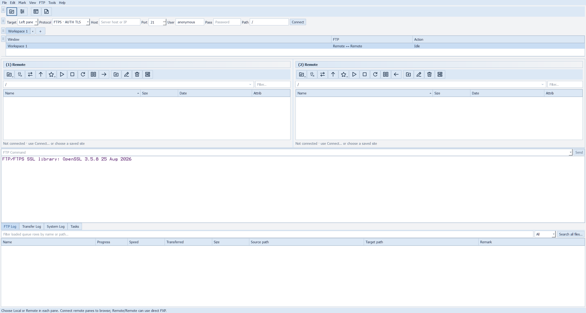
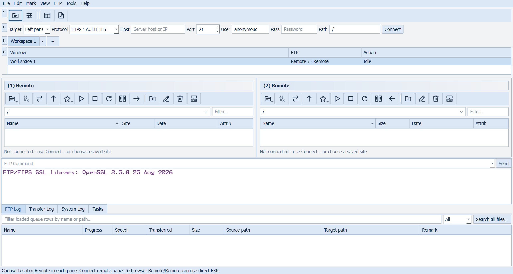
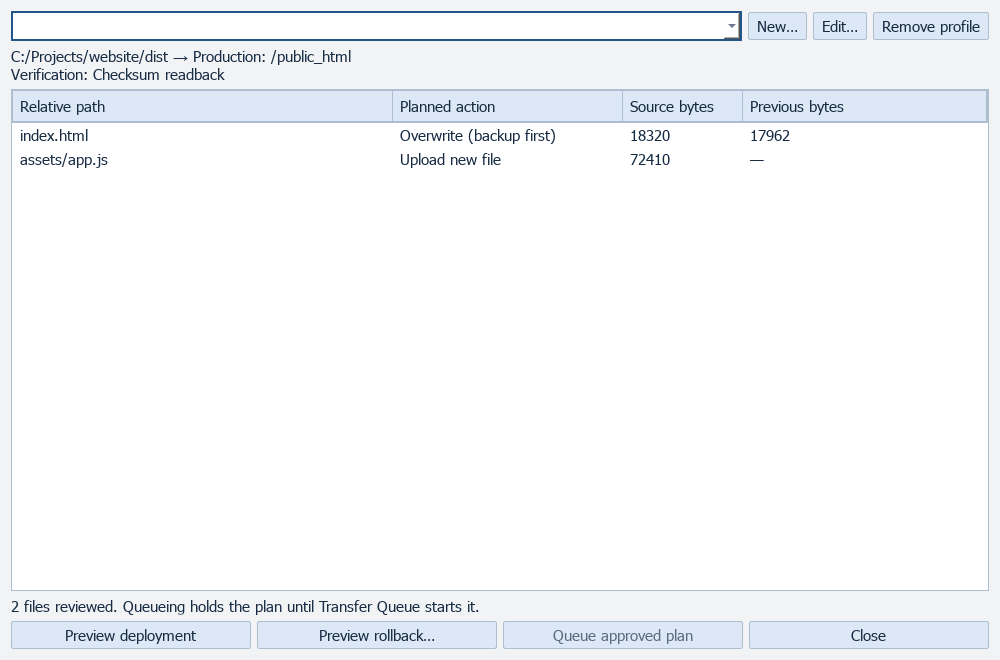
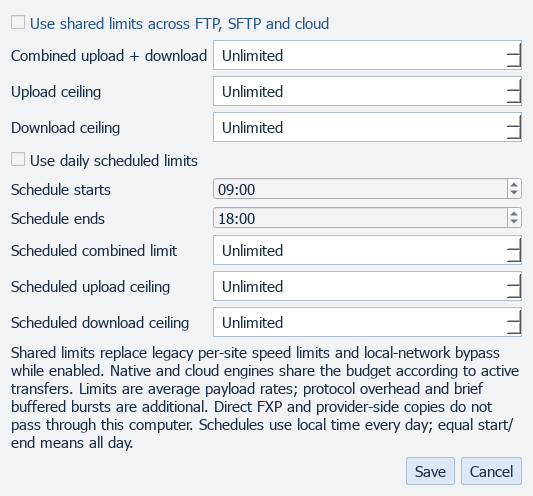
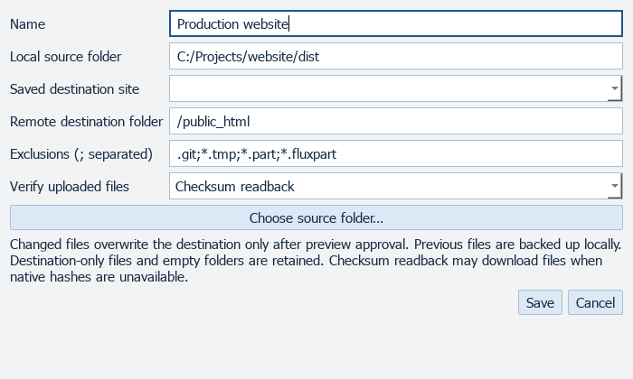

# FluxFTP

A Windows desktop client for FTP, FTPS, SFTP and cloud storage. FluxFTP combines
two-pane workspaces, recoverable transfer queues and deployment tools in a Qt
interface inspired by classic file-transfer clients.

**Source version: 0.122.0 · License: MIT · Primary platform: Windows x64**

Download the [Windows x64 ZIP](https://github.com/Taoism/FluxFTP/releases/latest).
Extract the entire archive, then run `FluxFTP.exe` inside the extracted folder.
Keep `_internal` beside the executable. No Python installation is required.
The package is unsigned; Windows may display an unknown-publisher warning.
SHA-256 checksums are provided with each release.

This repository also contains source code and tests. See
[Building from source](docs/BUILDING.md) to run or package a development build.
Other platforms are experimental.

## Independent trust and queue storage services — 0.122.0

Connections, the Certification Checker and trust prompts now share a Qt-independent
service for TLS pin scope, certificate validity, SSH fingerprints and known-host
persistence. TLS pin acceptance changes the live profile only after a successful
save. Desktop dialogs remain responsible for explicit trust approval.

Queue validation, atomic writes, import checks, disk buffers and snapshot readers
now run independently of Qt. The desktop captures job state and schedules I/O;
storage uses plain descriptors and stable job IDs. Existing version-1 recovery
and exported queue files remain compatible.

## Protocol adapter contract and capabilities — 0.121.0

A shared adapter contract now delegates file operations, payload transfers and
native checksum queries to existing connection backends. Immutable capabilities
drive route selection, payload pause, conflict-dialog resume choices and direct
FXP admission. SCP and cloud do not advertise byte-offset resume; native server
checksums remain conditional on negotiated extensions. Cloud-managed resumable
sessions are distinct from byte-offset resume. Holding queued jobs remains
available for every backend. Connection and trust implementations remain in
place for incremental migration.

## Queue engine and desktop controller — 0.120.0

A Qt-independent queue engine now owns pending and active work, admission limits,
priorities, retry budgets and cancellation bookkeeping. The desktop controller
connects workers, trust dialogs, progress, history and completion actions to that
engine. Existing controls, concurrency policy and recovery files are preserved.
Menus and storage share engine-owned state through compatibility properties while
those modules migrate incrementally.

## Independent transfer job model — 0.119.0

Transfer jobs now have stable IDs and explicit lifecycle states in a Qt-independent
model. A Qt adapter displays model changes while the existing scheduler continues
to run transfers. IDs survive retry, queue recovery and clear/restore, including
disk-buffered files. Importing existing live work assigns distinct IDs. Older
version-1 queue files remain supported. Scheduler extraction is a later step.

## Completion-marker queue cleanup — 0.118.0

Skipped informational rows such as `( 709M 10F - COMPLETE - Pop 2026 )` now
belong to the parent folder that discovered them. They remain while that folder
is queued or has unfinished/failed work, then clear when its parent is removed
from the queue, including explicit queue removal. Matching uses the existing
case-insensitive `- COMPLETE -` marker pattern. Ordinary skipped rows and markers
belonging to other folders remain independent. Transfer logs are retained;
this changes queue display cleanup only and never deletes source/destination files.

## Changes in 0.117.0

- Tools → Certification Checker reports TLS certificate validity, fingerprints,
  negotiated security and CA/hostname versus saved-pin trust. SSH reports verified
  host-key fingerprints; unknown keys are not saved. Reports export to JSON.
  Revocation and organizational certifications are outside this check.
- Queue and context-menu controls hold selected jobs, pause native payloads at
  progress checkpoints, resume selected jobs, or stop selected/all transfers.
  Queue pause remains between files. Active FXP, cloud and deployment operations
  cannot be paused mid-operation; queued jobs can still be held.
- SCP · SSH transfers payloads with legacy SCP over verified SSH. Browsing and
  metadata require SFTP; the server must also provide scp and a POSIX-compatible
  shell. Passwords, SSH keys and managed identities are supported. Nested folders
  use the ordinary queue. SCP does not support byte-offset resume; choose Overwrite
  or SFTP. Downloads publish only after checked completion.

## Changes in 0.116.0

- Successful uploads automatically leave the queue after their history is recorded.
  Completed folder files disappear as they finish; the folder clears when finished.
  Failed and pending transfers remain available.
- Includes the 0.115.0 fix for server-generated progress entries such as
  `[#:::::::::::::]-  9% Complete`: valid remote names no longer fail Windows filename
  validation during listing and block unrelated uploads. Local filename restrictions
  and remote path safety checks remain enforced.

## Changes in 0.114.0

- Retry uploads in Binary mode when a server explicitly rejects the initial ASCII
  upload. This fixes NFO/SFV uploads in Auto mode and M3U files configured as ASCII,
  preserving their original bytes. Other permission errors do not trigger fallback.
- Right-click Delete now removes nonempty remote folders and their contents after
  the configured confirmation. Deletion scans the selection first and refuses roots,
  unsafe paths, symbolic links and directory shortcuts. Local folders must still be empty.

## Features

- FTP, explicit/implicit FTPS and SFTP, with certificate and SSH host-key checks.
- Multiple two-pane workspaces, saved sites, remote editing and recursive search.
- Transfer queues with resume, retries, conflict handling and persistent recovery.
- Cloud storage through rclone, including S3, Google Drive, OneDrive and WebDAV.
- Folder synchronization with previews, checksums, saved profiles and reviewed deletions.
- Watch-and-upload folders and scheduled automation.
- Connection diagnostics for control, authentication and data-channel failures.
- Shared upload/download bandwidth budgets with daily schedules.
- Per-file verification reports exported as CSV or JSON.
- Deployment profiles with previews, local backups and guarded rollback.

## Screenshots

### Main interface — public Windows release

Captured directly from the public **FluxFTP 0.113.0 Windows executable**, using
temporary default settings. The disconnected workspace shows the two file panes,
connection controls, logs and transfer queue without exposing saved accounts.



<details>
<summary>Main interface with enlarged display scaling</summary>

The same public executable at 150% display scaling:



</details>

### Feature dialogs

These earlier dialog examples use synthetic demonstration paths and contain no live accounts.



<details>
<summary>Bandwidth settings and deployment profile</summary>





</details>

## Run from source

Install 64-bit Python 3.13, then run the following in a checkout using PowerShell:

```powershell
py -3.13 -m venv .venv
.\.venv\Scripts\python.exe -m pip install --upgrade pip
.\.venv\Scripts\python.exe -m pip install -e ".[dev]"
.\.venv\Scripts\python.exe -m fluxftp
```

FTP/FTPS/SFTP work without a cloud backend. For cloud features, build the pinned,
patched rclone backend as described in [BUILDING.md](docs/BUILDING.md).
Source builds use their Python installation's TLS runtime. The maintained Windows
release's optional OpenSSL 4 adapter is not included in this source repository.

## Connect and transfer

Open **Tools → Site Manager**, create a site and choose its protocol, host and
authentication details. Review certificate or SSH trust prompts before connecting.
Choose the local and remote folders in the panes, then queue the files to transfer.
Use Transfer Queue to review, start, pause or cancel queued work.

Cloud connections require both a backend and account authorization. Store secrets
through the app's credential controls; do not put passwords in repository files.
See [the user guide](docs/USER_GUIDE.md) for synchronization, watches, diagnostics,
bandwidth management, verification reports and deployments.

## Limitations

- Active FTP depends on server, firewall and router reachability; a UPnP mapping
  alone does not guarantee a working data connection.
- Cloud transfers generally restart files; native Google Drive uploads have
  provider-specific resumable recovery. Providers differ in supported operations.
- Verification reports describe checks actually performed. A size check is not
  a content checksum, and exporting history does not re-verify old files.
- Deployments update files individually, not as an atomic directory release.
  Concurrent remote edits and ambiguous interrupted writes require review.
- Shared bandwidth limits cover average payload rates within one app process.
  Metadata, protocol overhead and brief buffering bursts are additional.
- Development packages are unsigned and do not reproduce the maintained release's
  validated custom TLS runtime. macOS/Linux release validation remains incomplete.

## Development and contributions

See [BUILDING.md](docs/BUILDING.md) for dependencies, tests and packaging, and
[CONTRIBUTING.md](CONTRIBUTING.md) for changes and bug reports. The
[roadmap](docs/ROADMAP.md) lists planned work. Tests use temporary local fixtures;
never configure an automated test to use a production account.

For security-sensitive reports, follow [SECURITY.md](SECURITY.md). Do not attach
passwords, private keys, tokens or unredacted logs to issues.

## License

FluxFTP's original source and documentation are distributed under the
[MIT License](LICENSE). Dependencies retain their own licenses; see
[THIRD_PARTY_NOTICES.md](THIRD_PARTY_NOTICES.md).
