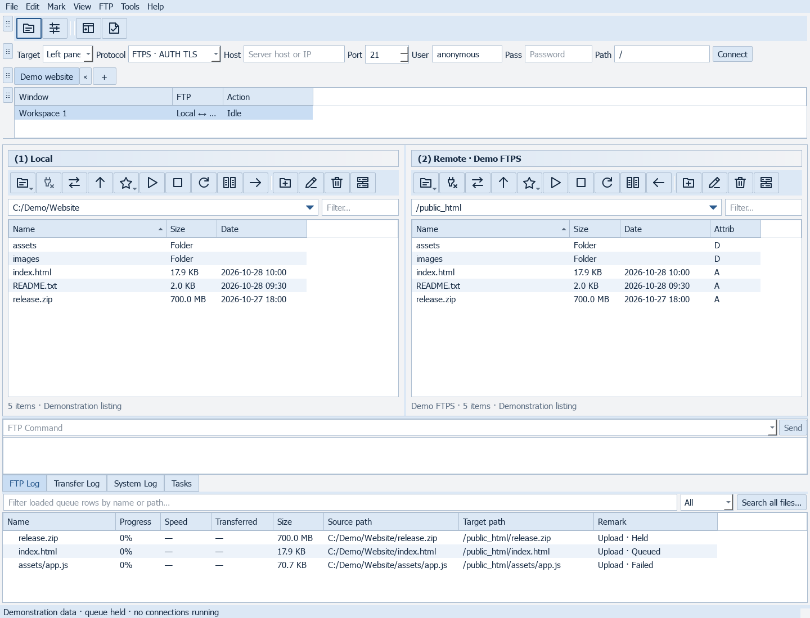

# FluxFTP screenshot gallery

101 screenshots of FluxFTP 0.122.0, grouped by feature.

These are captures of the actual application widgets, rendered with isolated settings and fictional demonstration data. Sample listings, queue states, accounts, reports and plans are illustrative; no servers were contacted and no transfers or authorizations were performed. Screenshots exclude personal sites, passwords and account data. Click an image to open the full-resolution PNG.

[Back to README](../README.md) · [User guide](USER_GUIDE.md) · [Screenshot files](screenshots)



## Browse by feature

| Feature area | Screenshots |
| --- | ---: |
| [Workspace](gallery/workspace.md) | 5 |
| [Transfers](gallery/transfers.md) | 11 |
| [Menus](gallery/menus.md) | 10 |
| [Connections](gallery/connections.md) | 3 |
| [Site properties](gallery/site-properties.md) | 16 |
| [Trust and diagnostics](gallery/trust-and-diagnostics.md) | 7 |
| [Cloud](gallery/cloud.md) | 3 |
| [Sync and deployment](gallery/sync-and-deployment.md) | 5 |
| [Automation](gallery/automation.md) | 4 |
| [Files](gallery/files.md) | 4 |
| [Getting started](gallery/getting-started.md) | 2 |
| [Options](gallery/options.md) | 31 |

## Coverage notes

- **Protocols:** FTP/FTPS, SFTP, SCP and cloud share the workspace and site properties. SCP setup and SSH/TLS reports have dedicated captures. Direct FXP and remote relay use the shared queue; protocol support does not imply every server supports every operation.
- **Transfers:** queue controls, active-transfer controls, scheduling, conditional transfer, recovery, search, conflicts, bandwidth, history, verification exports, manual downloads and TFTP.
- **Files and automation:** remote editing, external-editor review, associations, comparison, sync, deployment/rollback controls, watched uploads, scripts and command templates.
- **Configuration:** every Options category and every site-property category is pictured, including SSL runtime management, proxy/data connections, retry/priority rules, notifications, themes and layout.
- **Menus:** the menu captures document additional commands such as file search, remote attributes, selection, checksums and configuration backup. Disabled placeholder commands are not presented as implemented features.
- Internal services (job model, queue engine, protocol adapters, trust service and storage) have no separate UI; the screenshots show the controls they support.

## Reproduce

In a Windows source environment with the project dependencies installed:

```powershell
python scripts/capture_gallery.py
python scripts/build_screenshot_gallery.py
```

The capture script uses Qt offscreen rendering and temporary application settings. It neither changes user settings nor starts network operations. The build script generates these pages and contact sheets under the ignored `build/gallery-review` directory.
