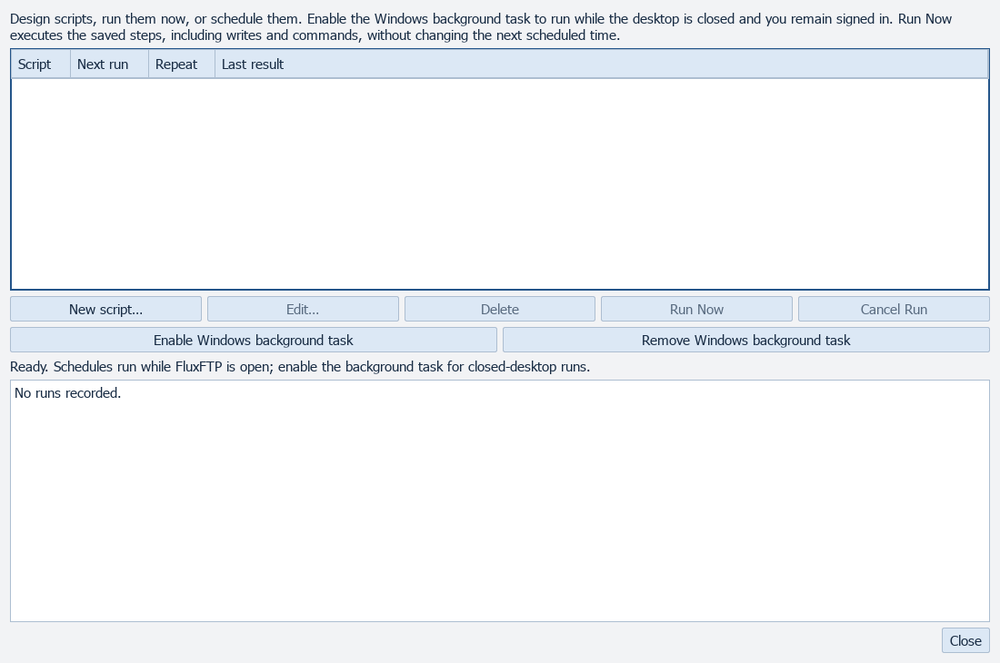
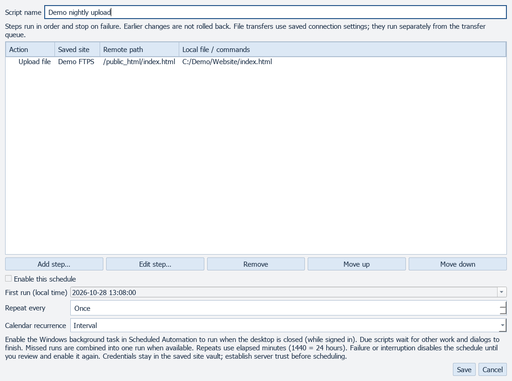
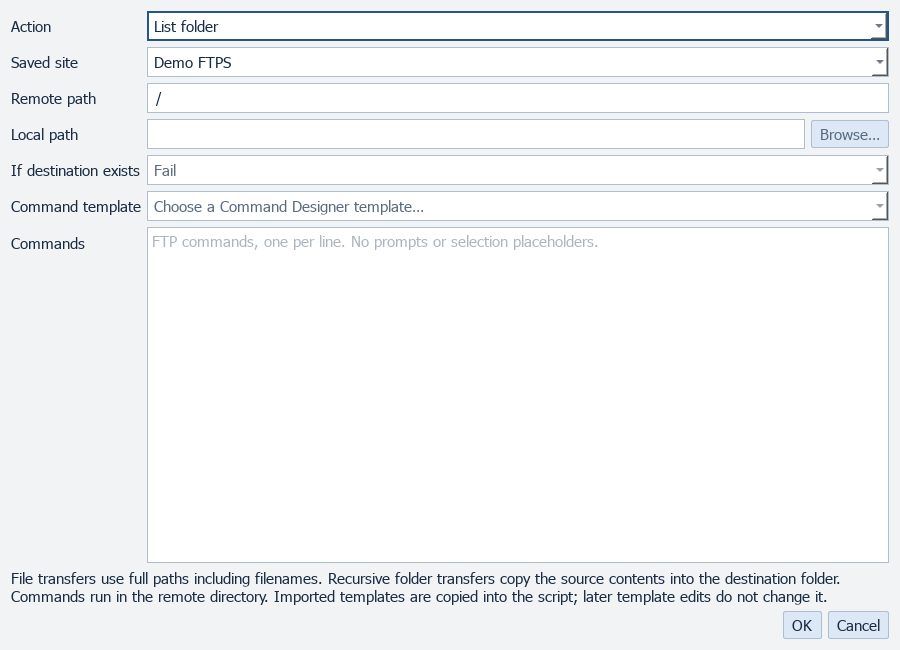
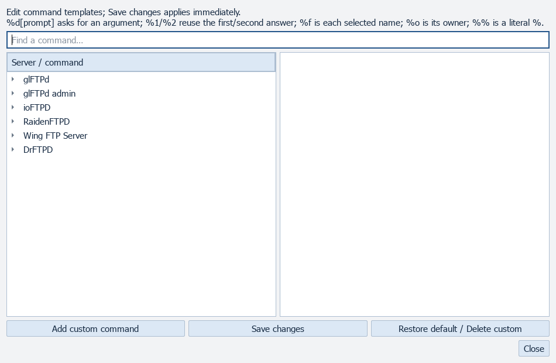

# Automation

[All screenshots](../SCREENSHOTS.md) · [User guide](../USER_GUIDE.md)

Actual FluxFTP widgets with fictional demonstration data. Click any image for full resolution.

## Scheduled automation

## Script Designer

Illustrative script step.

## Script step

## Command Designer

