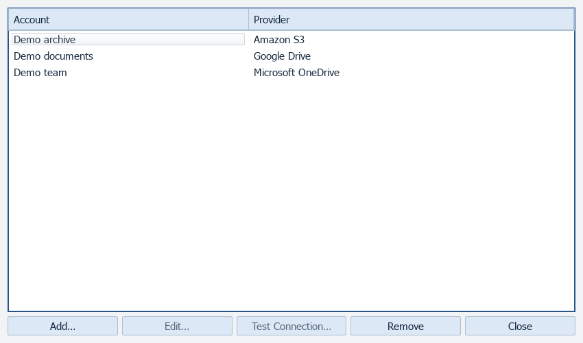
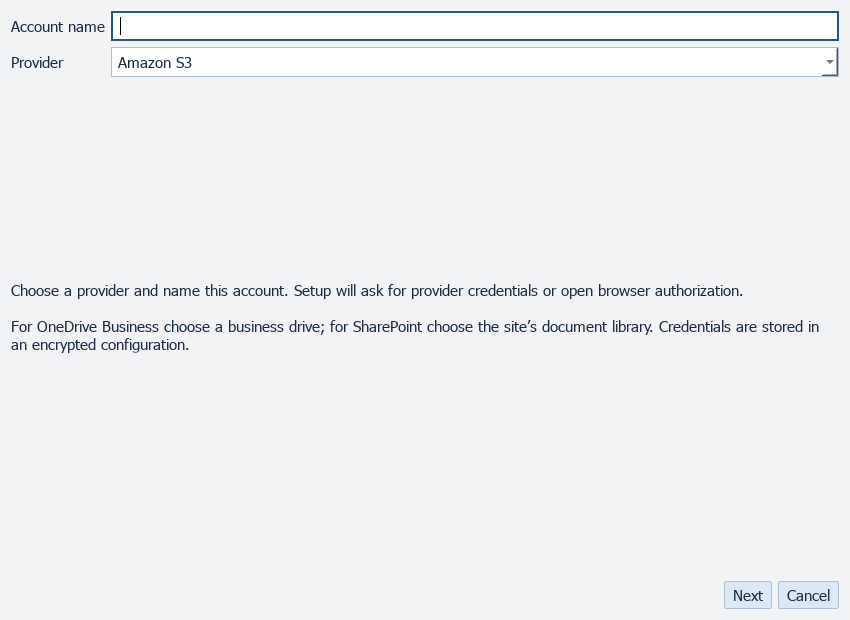
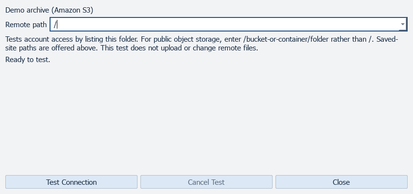

# Cloud

[All screenshots](../SCREENSHOTS.md) · [User guide](../USER_GUIDE.md)

Actual FluxFTP widgets with fictional demonstration data. Click any image for full resolution.

## Cloud accounts

Illustrative account rows; no linked accounts.

## Add cloud account

Provider setup before authorization.

## Test cloud access

Read-only connection test setup; no test is run.

