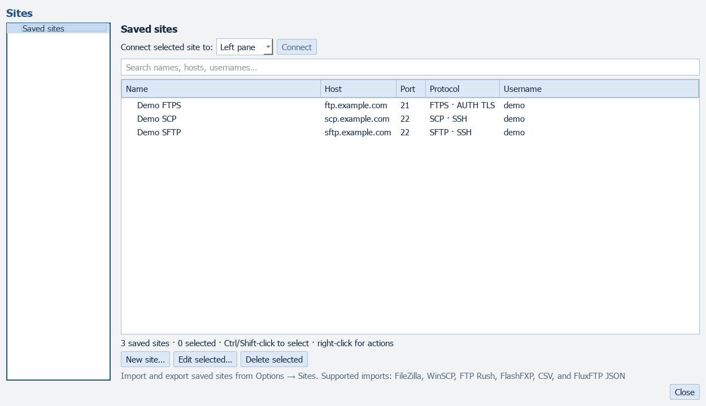
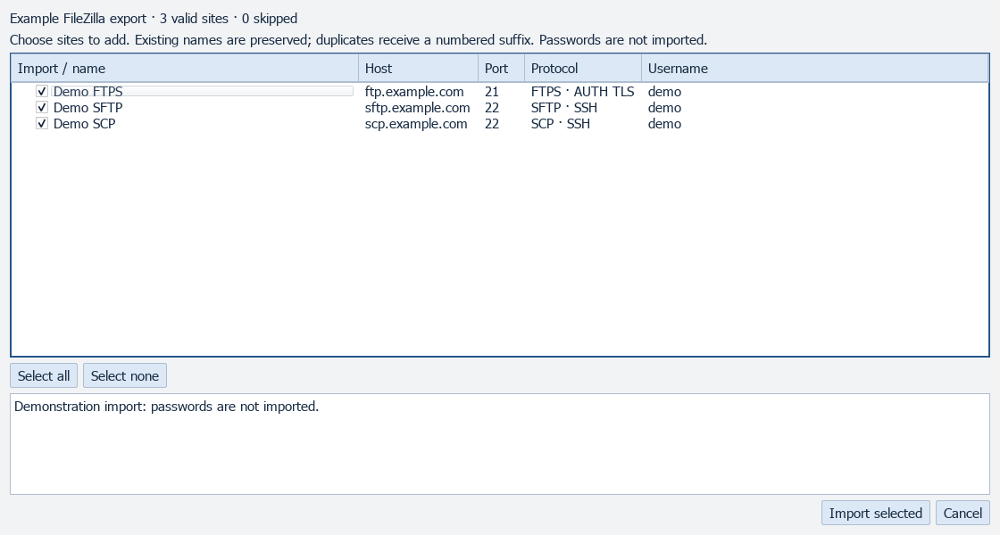
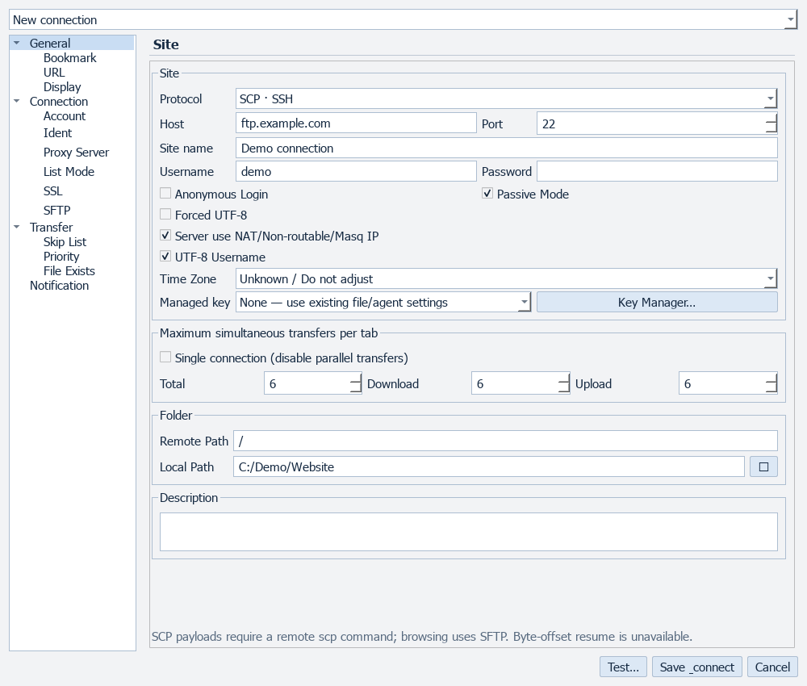

# Connections

[All screenshots](../SCREENSHOTS.md) · [User guide](../USER_GUIDE.md)

Actual FluxFTP widgets with fictional demonstration data. Click any image for full resolution.

## Site Manager

## Import sites

## SCP connection

Legacy SCP payloads use verified SSH; browsing requires SFTP.

