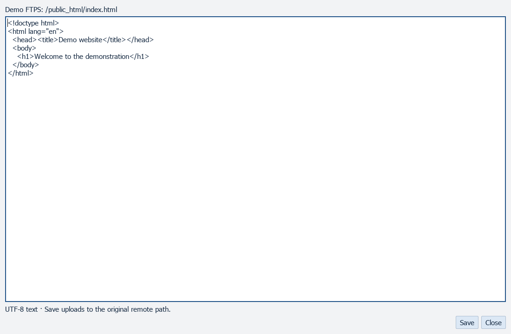
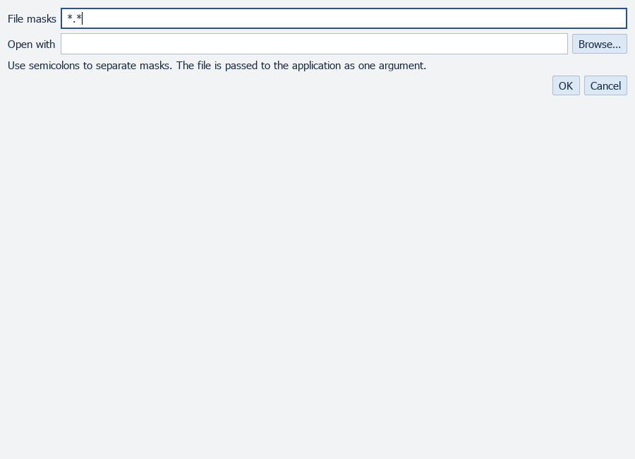
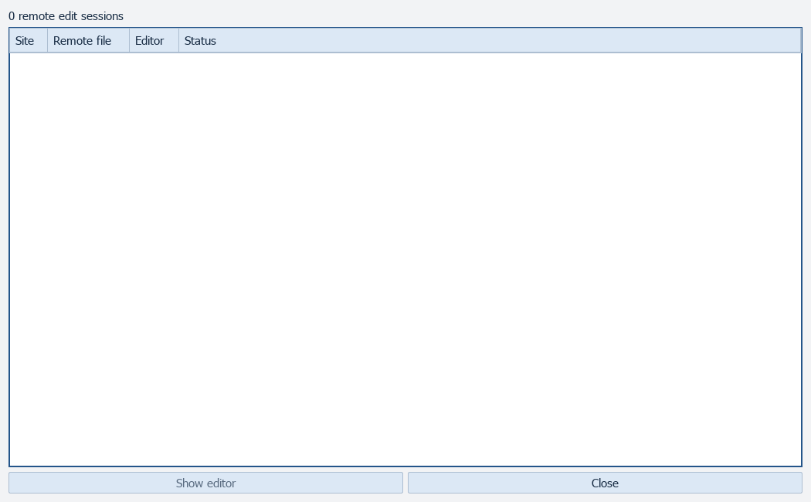
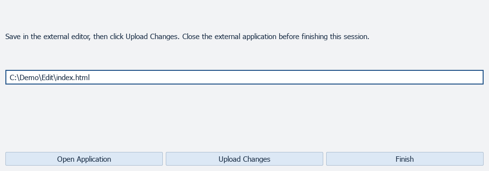

# Files

[All screenshots](../SCREENSHOTS.md) · [User guide](../USER_GUIDE.md)

Actual FluxFTP widgets with fictional demonstration data. Click any image for full resolution.

## Remote text editor

Sample text loaded locally; Save is not used.

## File association editor

## Active edit sessions

## External editor upload review

No external application is launched and no file is uploaded.

