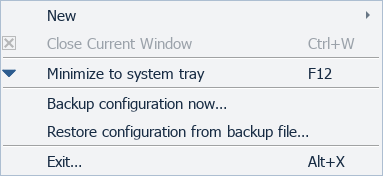
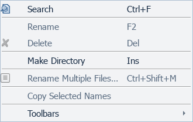
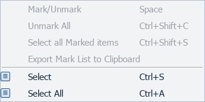
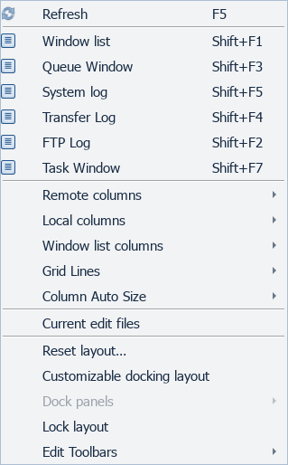
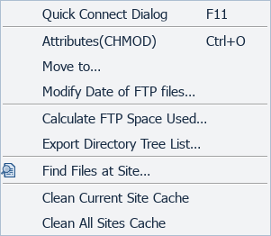
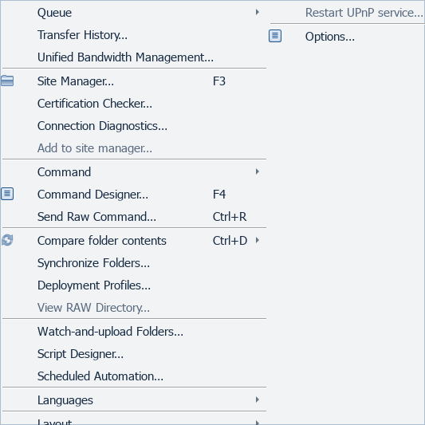
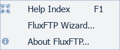
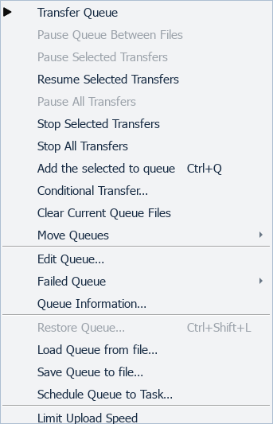
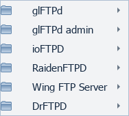
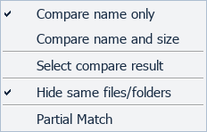

# Menus

[All screenshots](../SCREENSHOTS.md) · [User guide](../USER_GUIDE.md)

Actual FluxFTP widgets with fictional demonstration data. Click any image for full resolution.

## File

Disabled items are unavailable or unimplemented; their presence is not a feature claim.

## Edit

Disabled items are unavailable or unimplemented; their presence is not a feature claim.

## Mark

Disabled items are unavailable or unimplemented; their presence is not a feature claim.

## View

Disabled items are unavailable or unimplemented; their presence is not a feature claim.

## FTP

Disabled items are unavailable or unimplemented; their presence is not a feature claim.

## Tools

Disabled items are unavailable or unimplemented; their presence is not a feature claim.

## Help

Disabled items are unavailable or unimplemented; their presence is not a feature claim.

## Queue

## Commands

## Compare folders

