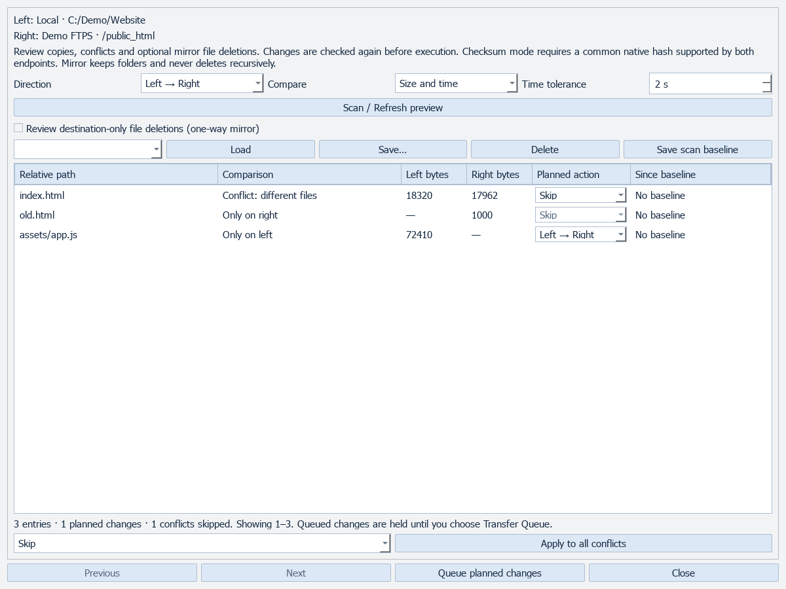
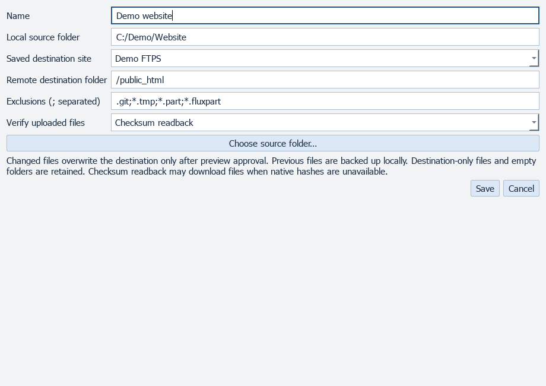
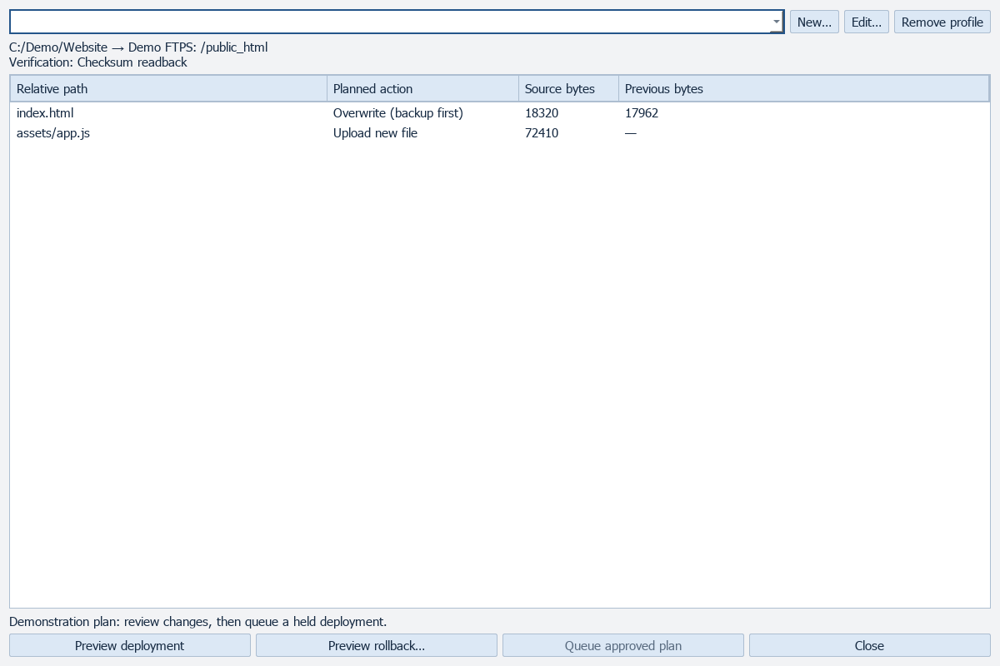
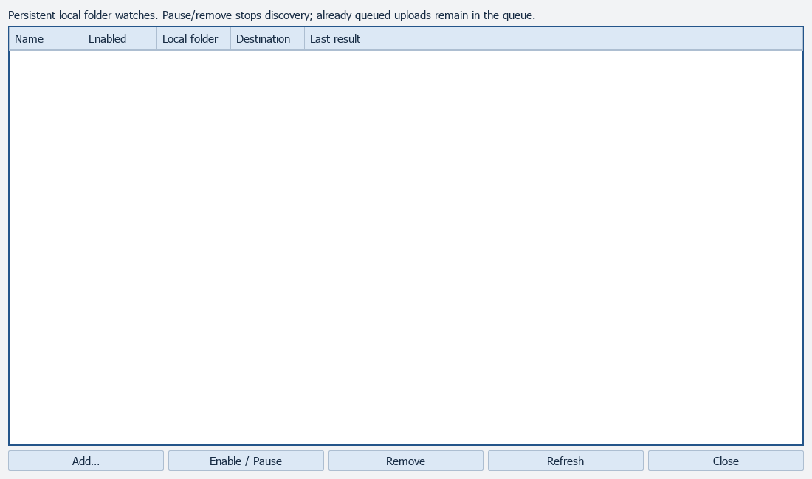
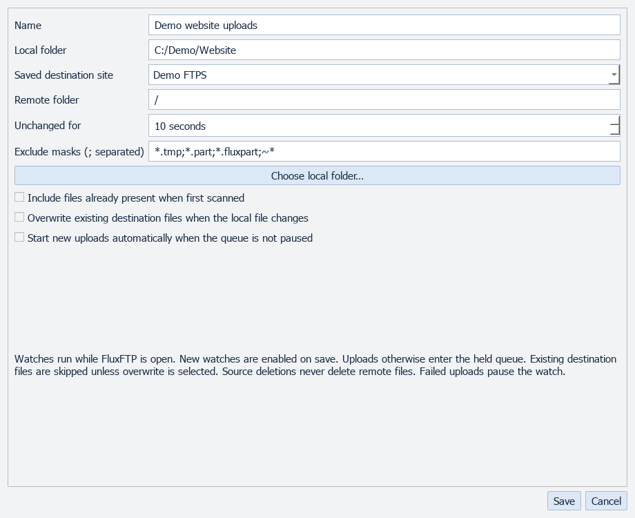

# Sync and deployment

[All screenshots](../SCREENSHOTS.md) · [User guide](../USER_GUIDE.md)

Actual FluxFTP widgets with fictional demonstration data. Click any image for full resolution.

## Synchronize folders

## Deployment profile

## Deployment preview and rollback controls

Illustrative plan; no deployment has run.

## Watch-and-upload folders

## Watch rule

