# Transfers

[All screenshots](../SCREENSHOTS.md) · [User guide](../USER_GUIDE.md)

Actual FluxFTP widgets with fictional demonstration data. Click any image for full resolution.

## Queue controls

Hold, pause, resume, stop, retry and queue management commands.

<a href="../screenshots/transfers-queue-controls.png">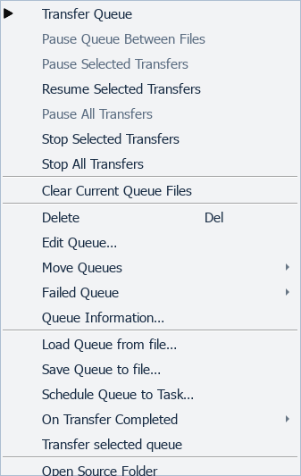</a>

## Active-transfer controls

Illustrative active state; the worker is not started.

<a href="../screenshots/transfers-active-transfer-controls.png">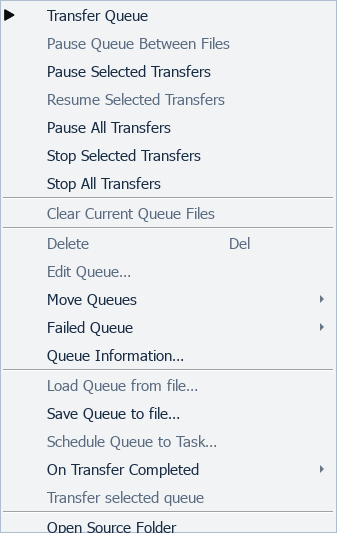</a>

## Schedule queued transfers

<a href="../screenshots/transfers-schedule-queued-transfers.png">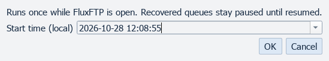</a>

## Conditional transfer

<a href="../screenshots/transfers-conditional-transfer.png">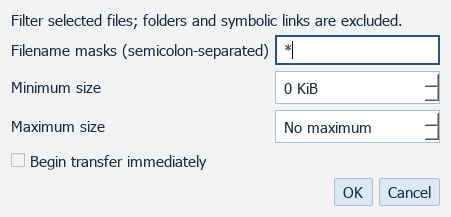</a>

## Unified bandwidth management

<a href="../screenshots/transfers-unified-bandwidth-management.png">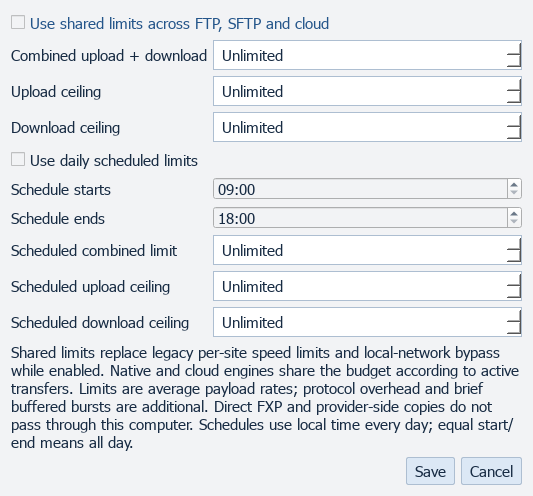</a>

## File conflict choices

<a href="../screenshots/transfers-file-conflict-choices.png">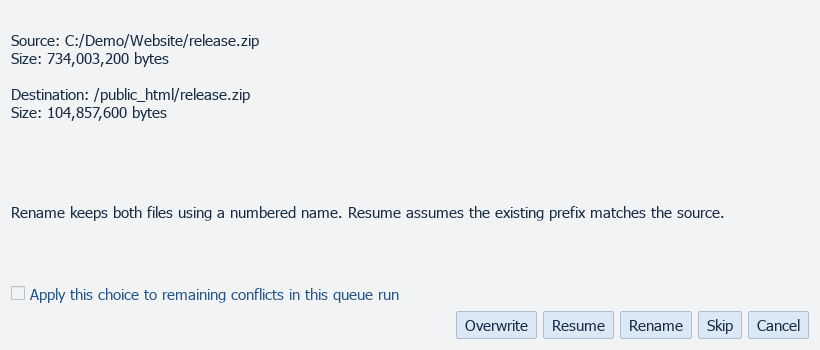</a>

## History and verification exports

Illustrative history; no transfer has run.

<a href="../screenshots/transfers-history-and-verification-exports.png">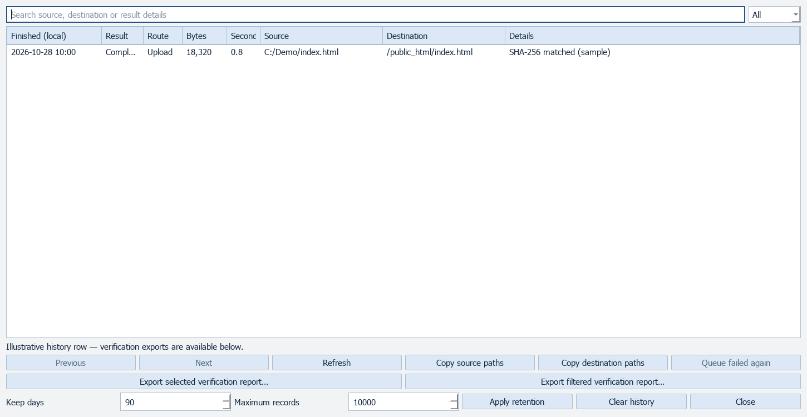</a>

## Queue recovery

<a href="../screenshots/transfers-queue-recovery.png">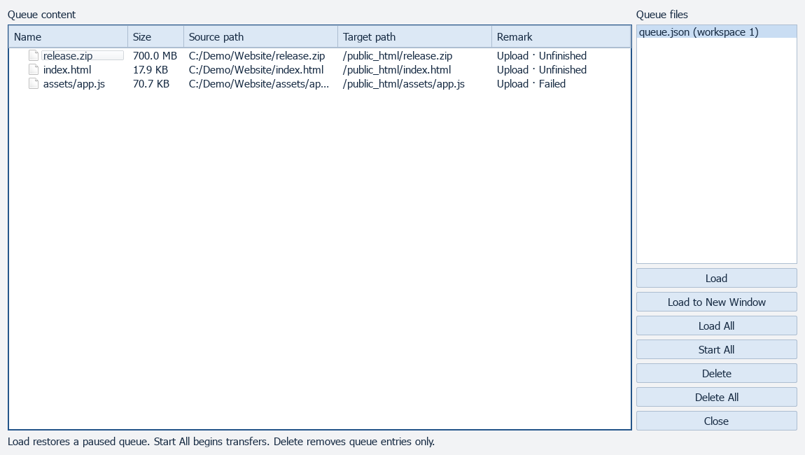</a>

## Search all queued files

<a href="../screenshots/transfers-search-all-queued-files.png">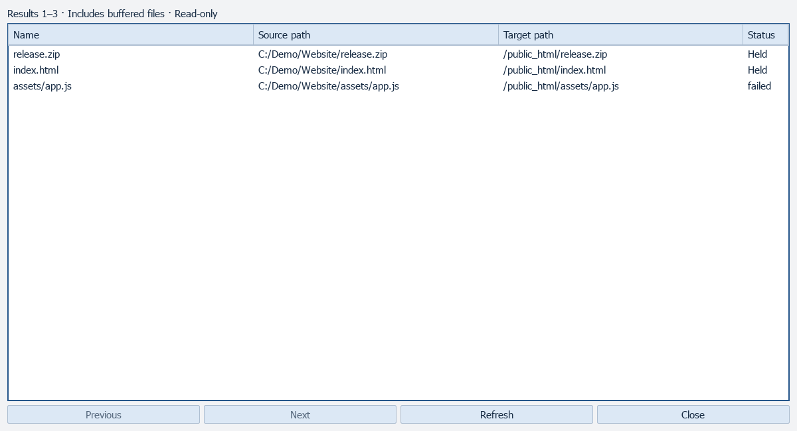</a>

## Manual download

<a href="../screenshots/transfers-manual-download.png">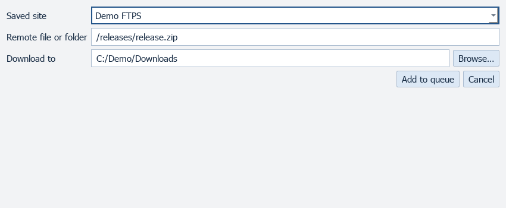</a>

## TFTP transfer

<a href="../screenshots/transfers-tftp-transfer.png">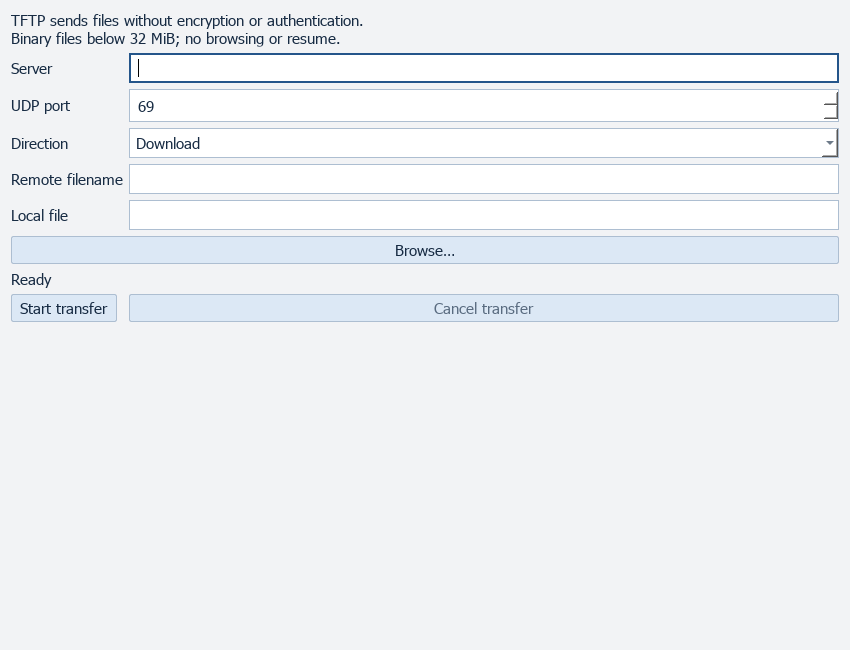</a>
