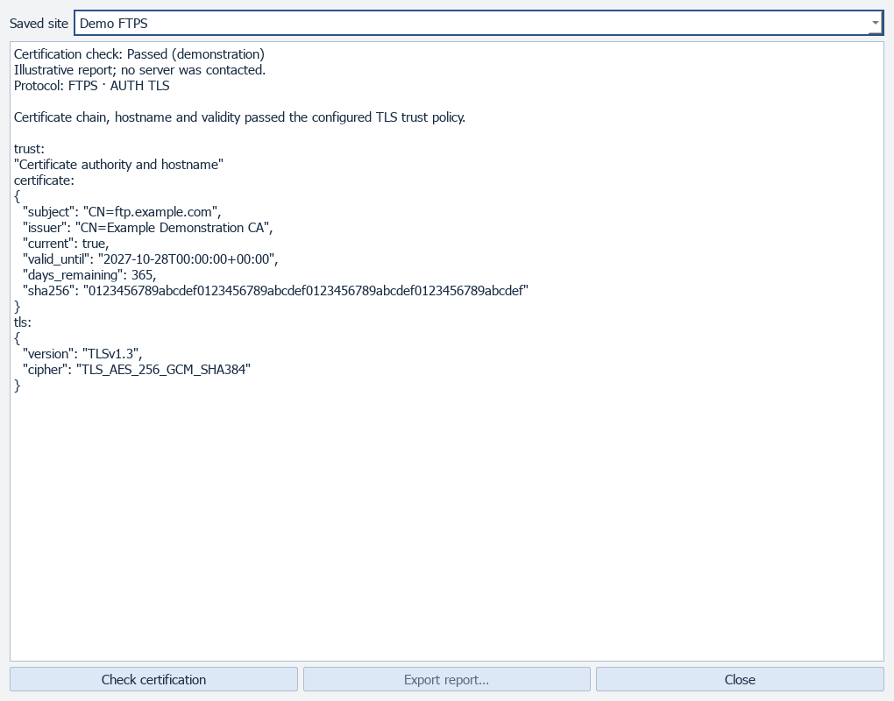
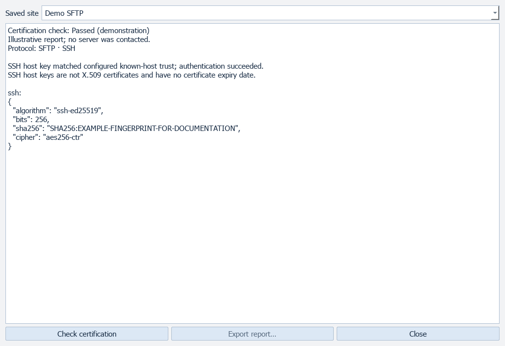
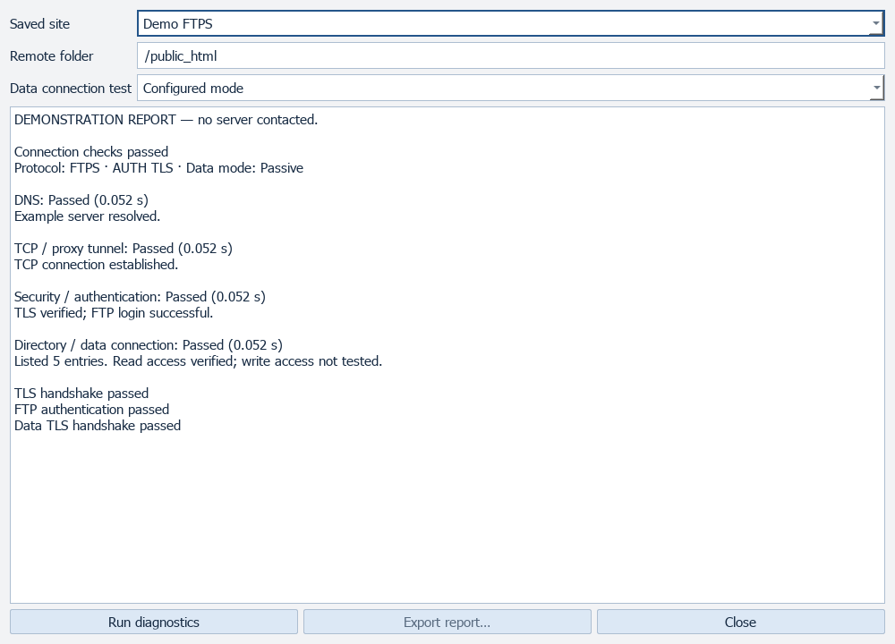
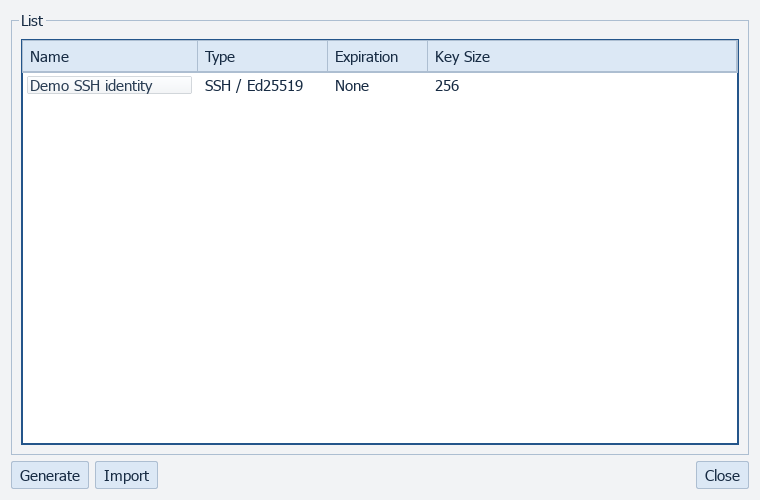
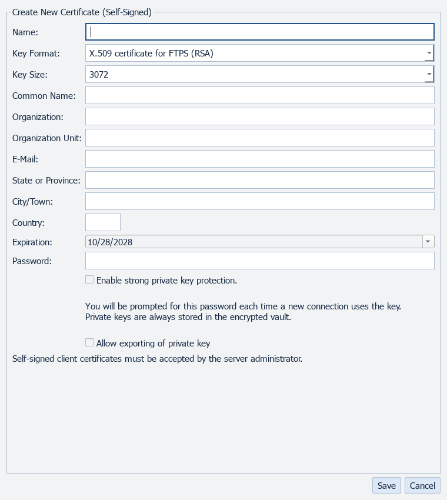
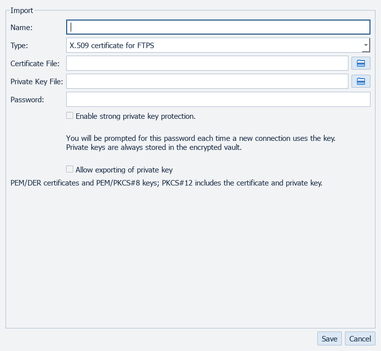
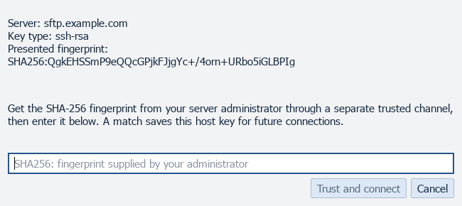

# Trust and diagnostics

[All screenshots](../SCREENSHOTS.md) · [User guide](../USER_GUIDE.md)

Actual FluxFTP widgets with fictional demonstration data. Click any image for full resolution.

## TLS certification report

Illustrative report, not a live certificate check.

## SSH trust report

Illustrative SSH report.

## Connection diagnostics

Illustrative report.

## Key Manager

Sample key metadata; no key is saved.

## Generate key or certificate

## Import key or certificate

## SSH host fingerprint approval

Disposable demonstration key; no trust is saved.

