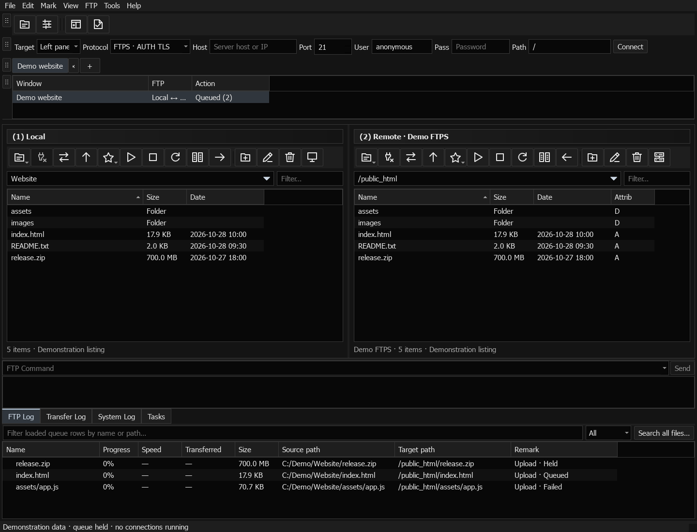
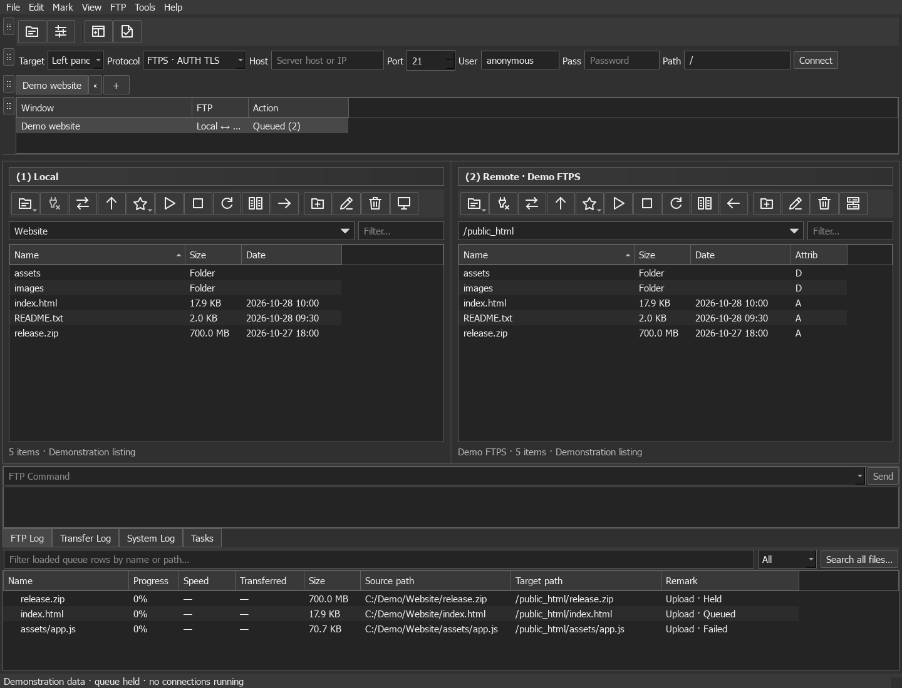
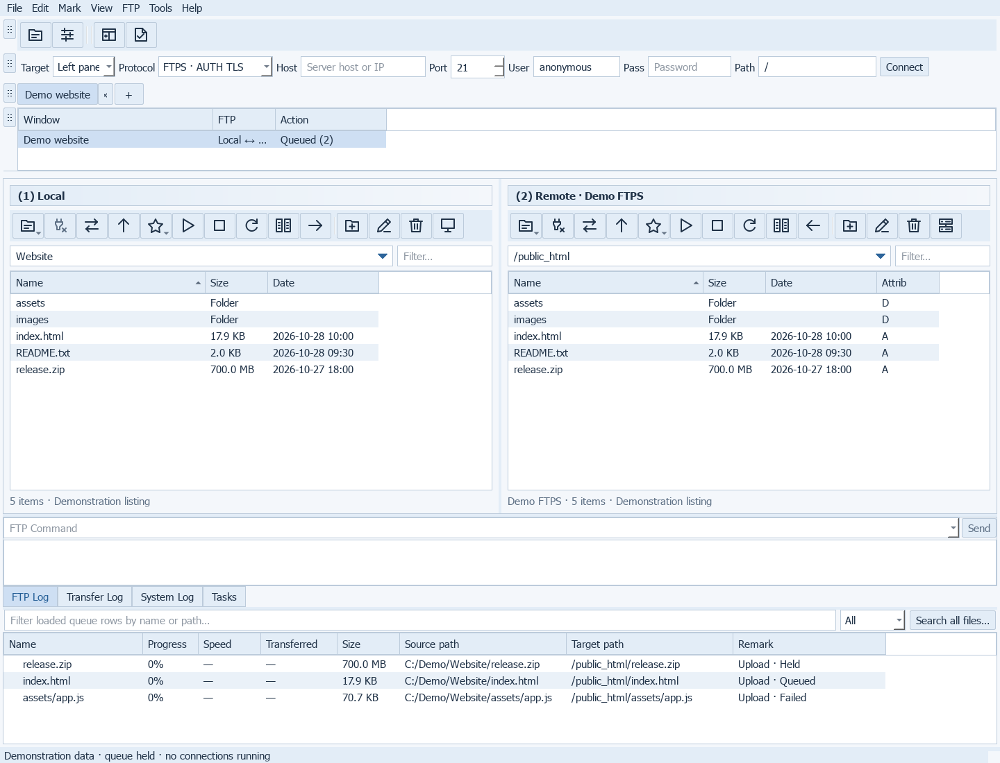
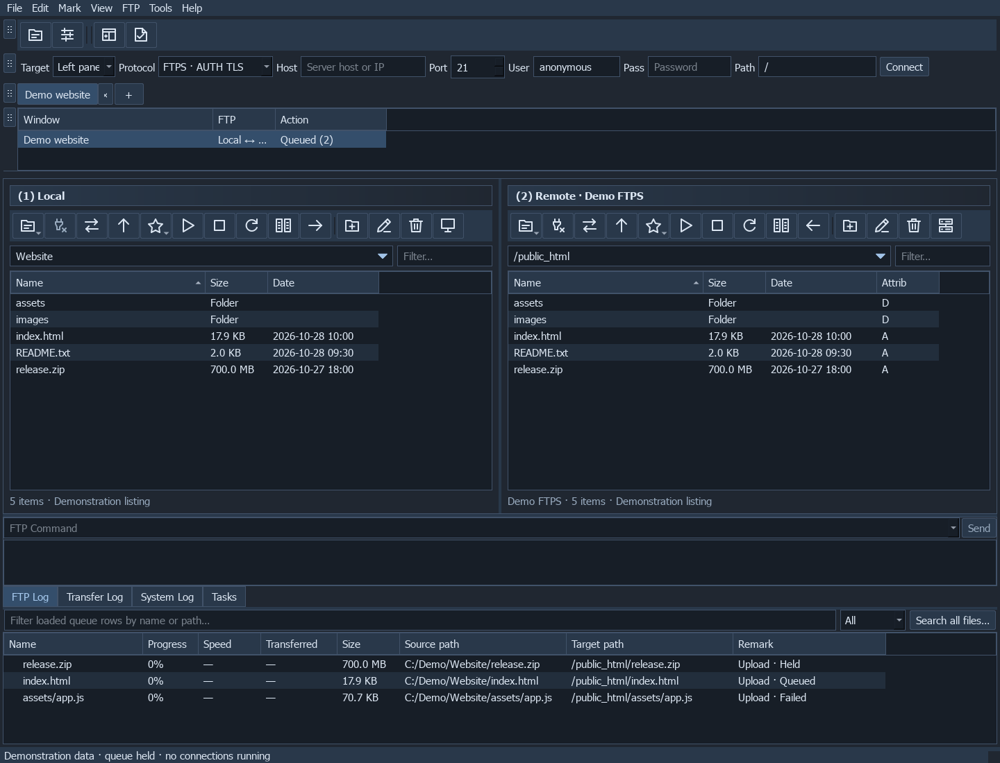

# Workspace

[All screenshots](../SCREENSHOTS.md) · [User guide](../USER_GUIDE.md)

Actual FluxFTP widgets with fictional demonstration data. Click any image for full resolution.

## Workspace and transfer queue

Sample directory listings and held/failed jobs.

## Black theme

Same demonstration workspace with a different application theme.

## Dark Grey theme

Same demonstration workspace with a different application theme.

## Light theme

Same demonstration workspace with a different application theme.

## Midnight theme

Same demonstration workspace with a different application theme.

